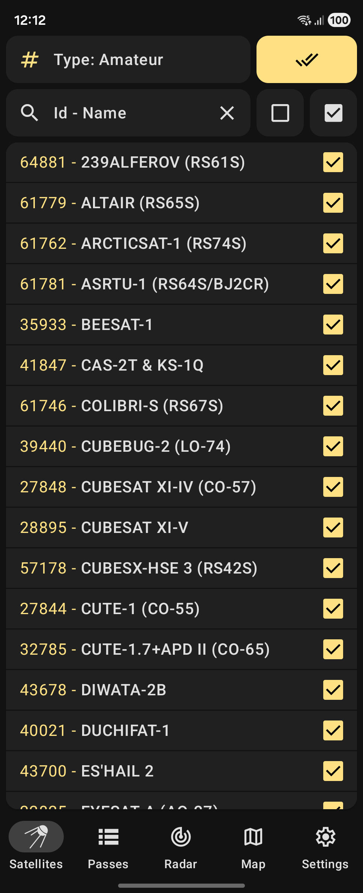
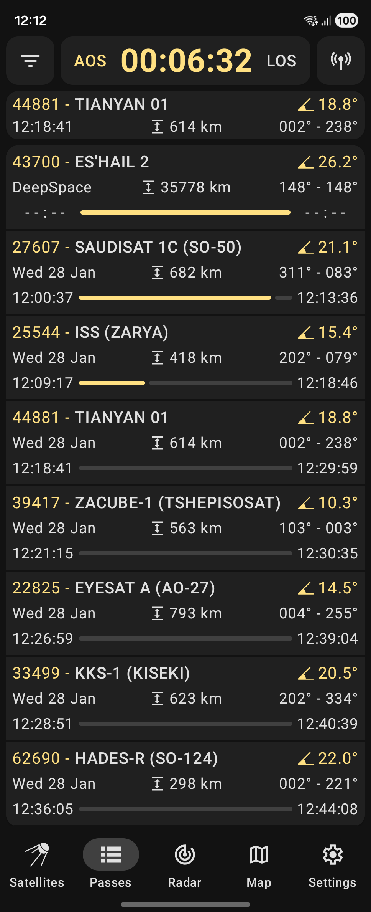
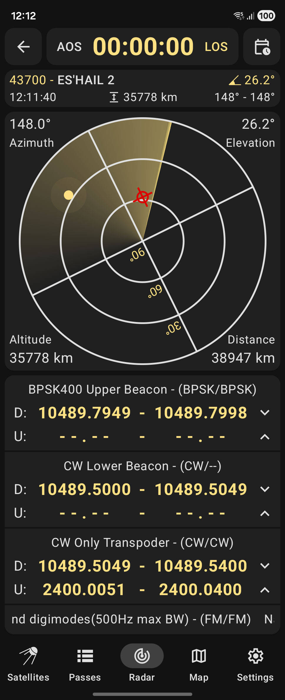
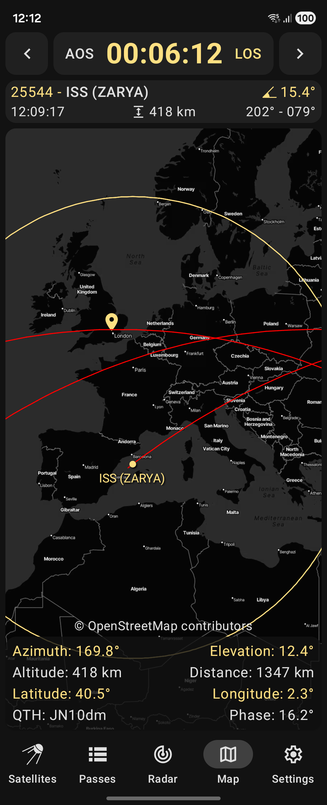

# Look4Sat: Satellite tracker

> **This repository is a modified fork of Look4Sat 4.4.9.**
> Upstream: <https://github.com/rt-bishop/Look4Sat> — Copyright (C) 2019-2026 Arty Bishop
> and contributors, licensed under GPL-3.0-or-later.
> The release links below point at the **upstream** releases, not at builds of this
> fork. Every change made here is listed in [NOTICE](NOTICE), together with the
> attribution and the full disclaimer.
> Additional technical notes: [docs/ACCURACY.md](docs/ACCURACY.md).

Upstream releases: [Google Play](https://play.google.com/store/apps/details?id=com.rtbishop.look4sat) ·
[F-Droid](https://f-droid.org/packages/com.rtbishop.look4sat/) ·
[GitHub releases](https://github.com/rt-bishop/Look4Sat/releases)

### Radio satellite tracker and pass predictor for Android, inspired by Gpredict

<p float="left">




</p>

### Track satellite passes with ease!

Thanks to [Celestrak](https://celestrak.com/) and [SatNOGS](https://satnogs.org/) you have access to over 9000 active satellites.\
You can search the entire database by NORAD Catalog Number or the satellite's name.

Orbital positions and passes are calculated relative to your location.\
To get reliable data make sure to set the station position via the app Settings.

The application is built using Kotlin, Coroutines, Jetpack Compose and Navigation.\
It is now and always will be completely ad-free and open-source.

## Main features:

*  Predicting satellite positions and passes for up to 10 days
*  Showing the list of currently active and upcoming satellite passes
*  Showing the active pass progress, polar trajectory and transceivers info
*  Showing the satellite positional data, footprint and ground track on the map
*  Custom TLE satellite data import is available via Three Line Element .txt files
*  Offline first: calculations are made offline. Weekly TLE data update is recommended.

## Associated projects:

- [Look4Sat-rPi](https://github.com/kampji/Look4Sat-rPi) - An independent Raspberry Pi OS port of Look4Sat,
bringing satellite tracking to touchscreen devices.

## Star History

<a href="https://star-history.dera.page/#rt-bishop/Look4Sat&type=timeline&legend=top-left">
 <picture>
   <source media="(prefers-color-scheme: dark)" srcset="https://star-history.dera.page/svg?repos=rt-bishop/Look4Sat&type=timeline&theme=dark&legend=top-left" />
   <source media="(prefers-color-scheme: light)" srcset="https://star-history.dera.page/svg?repos=rt-bishop/Look4Sat&type=timeline&legend=top-left" />
   
 </picture>
</a>

## What this fork adds

Short version; the full list is in [NOTICE](NOTICE).

* **Pass analysis screen** — closest approach refined to ±100 ms, elevation and
  Doppler curves, polar sky track, sampling table, CSV and `.ics` export.
* **Saved sites** — named station coordinates, switched in one tap, with the
  station position and the active site moved in a single write.
* **Data that survives contact with reality** — TLE import from pasted text,
  a parser that tolerates blank lines, RFC 4180 CSV, catalogue export that
  round-trips back into the importer.
* **Accuracy you can see** — a self-trained model of how element age translates
  into pass-time error, shown on the workbench and used as the trigger for
  automatic refreshes (budget: 10 seconds).
* **Accessibility** — every icon button has a label; nothing is announced as
  just "button" any more.

## Building

Requirements: JDK 21, Android SDK with platform 37 and build-tools 37.x.
Gradle is provided by the wrapper.

```bash
./gradlew :app:assembleDebug          # debug build, installable
./gradlew :core:domain:test :core:data:test   # 243 unit tests
./gradlew :app:assembleRelease        # release, R8 + resource shrinking
```

Release signing is read from `keystore.properties` at the repository root:

```properties
storeFile=/absolute/path/to/release.jks
storePassword=...
keyAlias=...
keyPassword=...
```

Without that file the release build still succeeds and produces an **unsigned**
APK, so a clean checkout builds out of the box.

The application id defaults to `com.rtbishop.look4sat`, the upstream one: the
program is the same program, so a source build behaves like it. Publishing under
that id is not possible on Google Play (the listing belongs to upstream) and
installing it over an upstream build fails, because the signing key differs. To
build with your own id — which makes the app a separate install, with no upgrade
path from the current one — pass it per build, no file edits needed:

```bash
./gradlew :app:assembleRelease -Plook4sat.applicationId=org.example.look4sat
``` Never commit the keystore or its
password file; `.gitignore` excludes both.

Release builds run R8 in full mode with aggressive renaming
(`-repackageclasses`, `-allowaccessmodification`, `-adaptclassstrings`), resource
shrinking, stripped `android.util.Log` calls and no Play dependency metadata
block. The mapping file is written to
`app/build/outputs/mapping/release/mapping.txt`; it is the key to a crash report
and should be archived with each release but **not** published.

## Licence

GNU General Public License v3.0 or later — see [LICENSE](LICENSE).
Attribution, the list of modifications and the disclaimer are in [NOTICE](NOTICE).

## Disclaimer

This program predicts the positions of satellites from public two-line element
sets. Its output is an **estimate**, with an error that grows with the age of the
elements (roughly 46 km at 8 days, 292 km at 15 days, 1.45 Mm at 28 days for a
low-Earth orbit). Do not use it for navigation, collision avoidance, antenna
pointing where a wrong angle matters, or anything else where a wrong number can
hurt someone. Radio operation is the operator's own responsibility and requires
the appropriate licence. The program comes with **no warranty of any kind**; see
sections 15 and 16 of the GPL and section 4 of [NOTICE](NOTICE).
